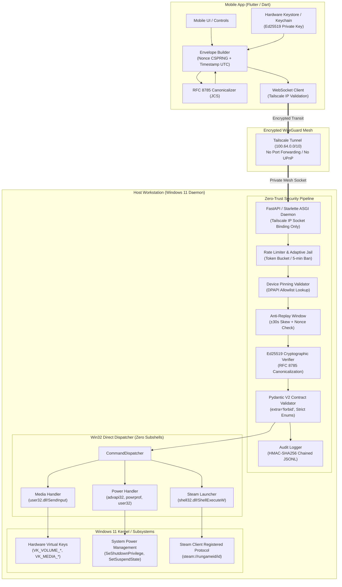

# SecureDeck (RemoteControler)
### Zero-Trust & Defense-in-Depth Personal Remote Control System for Windows 11

[](https://www.python.org/)
[](https://dart.dev/)
[-success.svg?logo=pytest&logoColor=white)](#testing--verification)
[](#threat-model--mitigations-stride)
[](https://tailscale.com/)
[](https://microsoft.com/windows)

---

## 1. Executive Summary

Most open-source personal remote control applications are fundamentally unsafe: they expose open TCP/UDP ports via UPnP, invoke unvalidated subshells (`cmd.exe /c ...` or `os.system(...)`), and transmit unauthenticated or weakly hashed packets across local networks. Opening an arbitrary execution channel on a personal workstation is mathematically equivalent to deploying an intentional backdoor.

**SecureDeck** is an open-source, contract-first remote control framework designed with a non-negotiable **Zero-Trust and Defense-in-Depth** security posture:
- **Zero Open Router Ports**: Operates exclusively over an authenticated private WireGuard overlay mesh (**Tailscale**). Absolute binding prohibition against `0.0.0.0`.
- **Zero Subshells**: Eliminates Remote Code Execution (RCE) by design. No strings are ever parsed by terminal interpreters; actions are executed strictly via low-level native Win32 APIs (`user32.dll`, `advapi32.dll`, `powrprof.dll`, `shell32.dll`).
- **Cryptographic Device Pinning**: Every message is an isolated, signed cryptographic envelope validated via **Ed25519** and canonicalized under **RFC 8785 (JCS)**, preventing cross-language serialization discrepancies between Dart/Flutter and Python.
- **Hardware-Backed Cryptography**: Host private keys and trusted allowlists are protected in Windows via **Data Protection API (DPAPI)** with secondary entropy; mobile private keys reside strictly in **Android Keystore** (StrongBox/TEE) or **iOS Keychain**.
- **Tamper-Evident Local Audit Trail**: Every event is committed to an append-only JSONL log chained via **HMAC-SHA256** and previous-block hashing, mathematically exposing any unauthorized modification or deletion.

---

## 2. Threat Model & Mitigations (STRIDE)

| Threat Category | Specific Attack Vector | Architectural Contramedida |
| :--- | :--- | :--- |
| **Spoofing** | Rogue device or unauthorized LAN neighbor attempting to issue commands. | **Mutual Device Pinning (Ed25519)**: Host verifies client public key against DPAPI-encrypted allowlist. Rogue keys fail in $O(1)$ before crypto processing. |
| **Tampering** | Man-in-the-Middle (MitM) altering parameters in transit (e.g. changing volume up to shutdown). | **RFC 8785 (JCS) + Ed25519 Signatures**: Every byte of the payload is sealed. Any modified field invalidates the signature immediately. |
| **Repudiation** | Malicious or accidental actions executed without audit evidence or post-incident log deletion. | **HMAC-SHA256 Hash-Chained Audit Trail**: Append-only log with recursive cryptographic hashing (`prev_hash`) sealed with a DPAPI-protected key. |
| **Information Disclosure** | Extraction of private keys from disk backups, memory dumps, or network sniffing. | **DPAPI + Keystore Storage**: Zero plaintext secrets on disk. Zero system paths or stack traces leaked over network responses. |
| **Denial of Service** | Command flooding, brute-force pairing token guessing, or nonce cache exhaustion. | **Token Bucket Rate Limiting + Adaptive 5-Minute Jail**: Jails any IP or device accumulating 3 consecutive authentication failures. Nonces are committed only after signature verification. |
| **Elevation of Privilege** | Command injection (`;`, `&`, `|`, `$()`) or path traversal (`../../cmd.exe`). | **Zero Subshell Execution**: Shell execution is strictly prohibited. Actions map to closed typed enums; game launching delegates to registered `steam://` protocol handlers. |

---

## 3. End-to-End Architecture



---

## 4. Technical Security Deep Dive

### A. Zero Subshell Policy
Executing external scripts via shell processes introduces catastrophic attack vectors like argument injection, command concatenation, and binary path hijacking:
- **Media Controls**: Directly constructs 64-bit aligned Win32 `INPUT` structures and calls `user32.dll!SendInput` with virtual hardware scan codes (`VK_MEDIA_PLAY_PAUSE`, `VK_VOLUME_UP`, `VK_VOLUME_DOWN`, `VK_VOLUME_MUTE`). Includes fallback to `user32.dll!keybd_event`.
- **System Power**: Acquires `SeShutdownPrivilege` in the host process access token via `advapi32.dll!OpenProcessToken` and `advapi32.dll!AdjustTokenPrivileges`, then calls `advapi32.dll!InitiateSystemShutdownExW` with structured shutdown reasons (`SHTDN_REASON_MAJOR_APPLICATION`). Lock workstation uses `user32.dll!LockWorkStation`; sleep and hibernate use `powrprof.dll!SetSuspendState`. Under no circumstances is `shutdown.exe` called.
- **Application Launching**: Completely avoids file system path arguments (`.exe`). Only numeric Steam AppIDs (`1 <= id <= 2147483647`) are validated by Pydantic and passed directly to `shell32.dll!ShellExecuteW` via the official protocol URI `steam://rungameid/<id>`.

### B. Hardware-Backed Secrets in Repositories
- **Host (Windows)**: All private keys and trusted allowlists are encrypted in `%APPDATA%\RemoteControler\secure_vault.dat` using `CryptProtectData` from `Crypt32.dll` (`CRYPTPROTECT_UI_FORBIDDEN`). An additional application-level **Secondary Entropy** salt is enforced, preventing lateral credential recovery by other processes running under the same user account.
- **Client (Mobile)**: The mobile Ed25519 private key is held strictly within `flutter_secure_storage` using Android Keystore (backed by hardware TEE/StrongBox) and iOS Keychain (`kSecAttrAccessibleAfterFirstUnlock`).

### C. Deterministic Canonicalization (RFC 8785 - JCS)
Cross-language cryptographic signatures frequently fail due to dictionary key ordering, JSON spacing, or Unicode escape differences (e.g. `{"a":1,"b":2}` vs `{"b":2,"a":1}`).
SecureDeck implements identical **RFC 8785 (JSON Canonicalization Scheme)** engines in both Python ([`host/core/crypto/canonical.py`](file:///c:/Users/marco/Desktop/RemoteControler/host/core/crypto/canonical.py)) and Dart ([`mobile/lib/crypto/canonical.dart`](file:///c:/Users/marco/Desktop/RemoteControler/mobile/lib/crypto/canonical.dart)):
1. Recursive key sorting strictly by UTF-16 code units.
2. Complete absence of whitespace around `:` and `,`.
3. Standardized IEEE 754 number and float serialization.
4. UTF-8 direct character representation without superfluous escape sequences.

### D. Anti-Replay & Nonce Cache Pollution Defense
Every command envelope carries a Unix timestamp (UTC) and a 16-byte CSPRNG hex nonce:
1. **Clock Skew Check**: Drops any message with $|T_{host} - T_{msg}| > 30$ seconds.
2. **Pre-check**: Verifies the nonce does not exist in memory cache.
3. **Delayed Commit**: The nonce is committed to the cache **only after** the Ed25519 signature is verified. This prevents unauthenticated attackers from exhausting the host's nonce cache memory with forged signatures.

---

## 5. Command Catalog & Data Contracts

All incoming payloads are strictly validated against closed Pydantic V2 models (`extra='forbid'`, `frozen=True`):

### 1. `MEDIA` Command
Controls hardware audio and playback devices without passing strings.
```json
{
  "command_id": "MEDIA",
  "payload": {
    "action": "PLAY_PAUSE"
  }
}
```
* **Supported Actions**: `PLAY_PAUSE`, `NEXT_TRACK`, `PREV_TRACK`, `VOLUME_UP`, `VOLUME_DOWN`, `VOLUME_MUTE`, `SET_VOLUME`.
* **Parameter Validation**: When `action` is `SET_VOLUME`, `volume_percent` is mandatory (`0 <= volume_percent <= 100`). Flooding is prevented with an internal hard cap of 50 steps.

### 2. `SYS_POWER` Command
Controls system power states directly via Win32 kernel calls.
```json
{
  "command_id": "SYS_POWER",
  "payload": {
    "action": "LOCK",
    "force": false
  }
}
```
* **Supported Actions**: `LOCK`, `SLEEP`, `HIBERNATE`, `REBOOT`, `SHUTDOWN`.
* **Parameter Validation**: `force: bool` controls forced application closing flags.

### 3. `APP_LAUNCH` Command
Launches games exclusively through the registered Steam client protocol.
```json
{
  "command_id": "APP_LAUNCH",
  "payload": {
    "platform": "STEAM",
    "app_id": 730
  }
}
```
* **Parameter Validation**: `platform` must be `STEAM`. `app_id` must be an integer between `1` and `2147483647`. Strings or paths are rejected by schema validation.

---

## 6. Installation & Setup Guide

### Prerequisites
- **Windows 11 / 10** (Host machine).
- **Python 3.12+** installed and added to PATH.
- **Dart SDK 3.13+** (or Flutter SDK) installed.
- **Tailscale** installed and connected on both PC and mobile device.

### 1. Repository Setup & Dependencies
```powershell
# Clone repository
git clone https://github.com/your-username/RemoteControler.git
cd RemoteControler

# Create and activate Python virtual environment
python -m venv .venv
.\.venv\Scripts\Activate.ps1

# Install host daemon dependencies
pip install -r requirements.txt

# Install mobile core Dart dependencies
cd mobile
dart pub get
cd ..
```

---

## 7. Testing & Verification

The architecture includes a comprehensive test suite of **54 automated unit, integration, and cross-platform tests passing with 100% success rate**:

### Run Host & Cross-Platform Suite (Pytest)
```powershell
# Executes 48 Python tests (Crypto, DPAPI, Handlers, Dispatcher, Audit, Server, Cross-Platform)
python -m pytest tests/ -v
```

### Run Mobile Dart Suite (Dart Test)
```powershell
# Executes 6 Dart unit tests (JCS RFC 8785, KeyManager, EnvelopeBuilder)
cd mobile
dart test
cd ..
```

---

## 8. CLI Usage Guide

The host daemon includes an administrative CLI ([`host/main.py`](file:///c:/Users/marco/Desktop/RemoteControler/host/main.py)) for pairing, execution, and audit verification.

### A. Pairing a New Mobile Device (Out-of-band Pairing)
Generates an ephemeral, signed challenge token (TTL 180s) and renders a QR code directly in the terminal:
```powershell
# On Tailscale network:
python host/main.py pair

# For local development testing:
python host/main.py pair --dev
```
The mobile app scans the QR code, verifies the host's Ed25519 signature, and securely exchanges public keys via `POST /pair`.

### B. Starting the Host Daemon
Starts the secure WebSocket daemon. The daemon automatically discovers your Tailscale CGNAT IP (`100.64.0.0/10`), validates the audit log chain, and binds exclusively to the private network interface:
```powershell
# Production mode (Requires active Tailscale connection):
python host/main.py run

# Local development mode (Permits loopback 127.0.0.1 binding):
python host/main.py run --dev
```

### C. Verifying Cryptographic Audit Log Integrity
Validates that no records in `%APPDATA%\RemoteControler\audit.log` have been tampered with, deleted, or inserted:
```powershell
python host/main.py verify-audit
```
Output:
```text
=================================================================
      AUDITORÍA DE INTEGRIDAD CRIPTOGRÁFICA (HMAC-SHA256)
=================================================================
[*] Archivo de Log: C:\Users\marco\AppData\Roaming\RemoteControler\audit.log
[+] ESTADO: ÍNTEGRO (Válido)
[+] Detalle: Integridad validada exitosamente: 52 registros verificados sin alteraciones.
=================================================================
```

---

## 9. License & Security Notice

Distributed under the **MIT License**.

> [!IMPORTANT]
> **Responsible Security**: This project provides direct remote interaction capabilities on a personal PC. Always ensure your host is connected only to your personal, authenticated Tailscale tailnet. Never commit private keys (`.pem`, `.key`, `secure_vault.dat`) or share pairing tokens.
